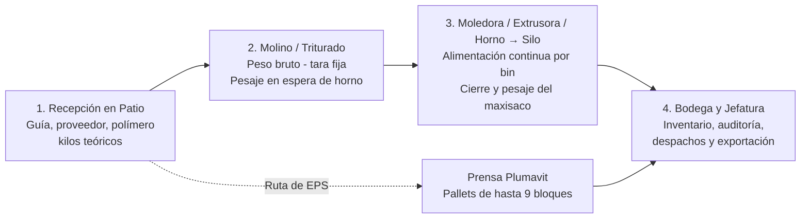

# GreenSpot Planta — Sistema de Trazabilidad y Control de Merma Industrial


GreenSpot Planta es una aplicación web mobile-first para registrar y consultar la operación de reciclaje industrial en Puerto Montt. Acompaña el flujo de plásticos y poliestireno expandido (EPS) desde la recepción hasta el pesaje de pellet, el inventario y los despachos.

El sistema mantiene trazabilidad operacional de contenedores reutilizables (**bins**) con códigos QR permanentes, registra pesos y estados en Supabase, y permite consultar el balance de masa entre recepciones, bins y maxisacos. El cierre de una corrida calcula la merma térmica; cuando supera el **8 %**, solicita una causal técnica antes de completar el proceso. Jefatura dispone de inventario, historial, auditoría y gestión de salidas.

> **Alcance del balance:** recepción almacena kilos teóricos calculados desde las unidades descargadas; Molino registra kilos netos pesados y Extrusión/Silo compara scrap alimentado con pellet pesado. La alerta operativa de merma superior al 8 % corresponde al cierre de la corrida de extrusión.

## Arquitectura y flujo operativo de planta

La aplicación tiene cuatro etapas principales y una ruta operativa complementaria para prensado de EPS:



### 1. Recepción de materia prima — Patio

`src/pages/RecepcionPatio.jsx` registra la guía de despacho del camión, proveedor y tipo de residuo. Las cantidades aceptadas y rechazadas se utilizan para calcular kilos teóricos con el peso unitario configurado en `tipos_residuo`. El historial muestra el folio interno y la guía física del camión.

### 2. Molino / Triturado — `MolinoScrap.jsx`

El operario selecciona o escanea un bin disponible, elige el tipo de residuo e ingresa el peso bruto. El sistema resta la tara fija de `bins_maestro` para obtener el peso neto y crea un pesaje en estado `EN_ESPERA_HORNO`. Al registrar el pesaje, el bin cambia de `DISPONIBLE` a `CARGADO`.

La vista se sincroniza al recuperar el foco y mediante Supabase Realtime para cambios en `bins_maestro` y `pesajes_scrap`. El selector excluye además cualquier bin que tenga un pesaje activo esperando horno.

### 3. Línea integrada Moledora – Extrusora – Horno → Silo — `ExtrusionSilo.jsx`

Se selecciona el polímero y se abre o retoma un maxisaco `EN_LLENADO`. Los bins en espera del mismo polímero se vacían de forma incremental, por escaneo QR o selección:

1. El pesaje pasa de `EN_ESPERA_HORNO` a `CONSUMIDO_EN_HORNO` y queda asociado a la corrida.
2. El bin físico se libera de inmediato y vuelve a `DISPONIBLE`.
3. Los kilos netos se acumulan en el maxisaco activo.
4. Al ingresar el peso neto de pellet medido en la báscula de silo, se calcula la merma y se cierra el maxisaco como `EN_BODEGA`.

La estación Molino recibe los cambios de bins y pesajes por Realtime; la pantalla de Extrusión vuelve a cargar sus datos después del vaciado. Si la merma supera el 8 %, se exige una causal técnica antes del cierre.

### 4. Bodega, despachos y panel de Jefatura — `DashboardJefatura.jsx`

El panel presenta indicadores e inventario vivo, consulta el historial de recepciones, pesajes, corridas, pallets, despachos y auditoría, y permite exportar los historiales a Excel (`.xlsx`). Jefatura puede despachar maxisacos o pallets EPS y administrar bins y cuentas de personal.

Los maxisacos se identifican con un vale como `VALE-0001`. En la pestaña de Maestros se generan e imprimen etiquetas QR fijas para los bins.

El inventario se desglosa por polímero y los historiales permiten revisar recepciones, pesajes y corridas por material. El KPI de merma visible en el panel corresponde al promedio general de corridas; no hay actualmente un KPI agregado de merma por polímero.

### Ruta complementaria — Prensa de Plumavit — `PlumavitEPS.jsx`

La ruta de EPS administra varios pallets en proceso entre turnos. Cada bloque prensado incrementa el avance hasta un máximo de nueve; los pallets completos quedan disponibles para traslado a Bodega Exterior y posterior despacho.

## Estructura del proyecto

Árbol de archivos de aplicación y configuración relevantes:

```text
greenspot-planta/
├── public/
│   ├── favicon.svg                 # Favicon y recurso de icono de la PWA
│   ├── icons.svg                   # Recursos SVG estáticos
│   └── manifest.json               # Nombre, modo standalone, colores e icono PWA
├── src/
│   ├── assets/
│   │   ├── hero.png                # Imagen estática de la aplicación
│   │   ├── react.svg               # Recurso SVG
│   │   └── vite.svg                # Recurso SVG
│   ├── lib/
│   │   └── supabaseClient.js       # Cliente Supabase y validación de configuración
│   ├── pages/
│   │   ├── DashboardJefatura.jsx   # KPIs, inventario, despacho, maestros e historial
│   │   ├── ExtrusionSilo.jsx       # Línea, alimentación de bins y cierre de maxisacos
│   │   ├── Login.jsx               # Acceso por usuario y rol
│   │   ├── MolinoScrap.jsx         # Pesaje de bins y sincronización de disponibilidad
│   │   ├── PlumavitEPS.jsx         # Seguimiento de pallets de EPS
│   │   └── RecepcionPatio.jsx      # Recepciones, folios e historial de guías
│   ├── App.css                     # Hoja de estilos presente en el proyecto
│   ├── App.jsx                     # Sesión, roles y navegación de estaciones
│   ├── index.css                   # Entrada de Tailwind CSS v4
│   └── main.jsx                    # Punto de entrada React
├── .env                            # Configuración local; ignorada por Git
├── .gitignore                      # Excluye secretos, dependencias y artefactos
├── eslint.config.js                # Configuración de ESLint
├── index.html                      # Documento raíz, manifest y theme color
├── package.json                    # Dependencias y scripts
├── package-lock.json               # Versiones bloqueadas de npm
├── vite.config.js                  # Plugins React y Tailwind para Vite
└── README.md
```

En esta versión no existe `src/components/`: las vistas operativas están organizadas en `src/pages/`. Tampoco existe `vercel.json`. La aplicación navega mediante estado de React desde `/` y no define rutas URL anidadas; Vercel puede detectar y construir el proyecto Vite desde su configuración estándar. Si se incorporan rutas directas en el futuro, se debe revisar entonces si hace falta una regla de fallback SPA.

`node_modules/` y `dist/` son directorios generados localmente y no forman parte del código fuente versionado. El repositorio no incluye migraciones SQL; el esquema, las relaciones, las políticas RLS y la publicación Realtime se configuran en Supabase.

## Tecnologías y dependencias

| Tecnología / paquete | Uso en el proyecto |
|---|---|
| React 19 | Interfaz y estado de las estaciones |
| Vite 8 | Servidor de desarrollo y compilación |
| Tailwind CSS 4 | Estilos responsive; cargado desde `src/index.css` |
| `@supabase/supabase-js` | Consultas PostgreSQL, actualizaciones y Realtime |
| `html5-qrcode` | Escaneo de QR mediante cámara |
| `qrcode.react` | Generación local de códigos QR imprimibles |
| `lucide-react` | Iconografía |
| `xlsx` | Exportación de historiales a Excel |
| ESLint | Análisis estático del código |

Scripts declarados en `package.json`:

| Comando | Acción |
|---|---|
| `npm run dev` | Inicia Vite en modo desarrollo |
| `npm run lint` | Ejecuta ESLint |
| `npm run build` | Genera la compilación de producción en `dist/` |
| `npm run preview` | Sirve localmente la compilación de producción |

## Instalación, configuración y despliegue

### Requisitos previos

- Node.js **20.19+** o **22.12+** y npm (versiones requeridas por Vite 8).
- Proyecto y cuenta de Supabase con acceso al esquema PostgreSQL.
- Cuenta de Vercel si se desea publicar desde Git.
- Para escanear QR, navegador con permiso de cámara. En producción, el acceso a cámara requiere contexto seguro HTTPS; Vercel proporciona HTTPS en sus dominios.

### 1. Clonar e instalar

```bash
git clone <URL_DEL_REPOSITORIO>
cd greenspot-planta
npm install
```

### 2. Configurar Supabase

Crea un archivo `.env` en la raíz del proyecto:

```dotenv
VITE_SUPABASE_URL=https://<PROJECT_REF>.supabase.co
VITE_SUPABASE_ANON_KEY=<SUPABASE_ANON_O_PUBLISHABLE_KEY>
```

Reemplaza los valores de ejemplo por la URL del proyecto y su clave pública correspondiente. No coloques una `service_role` key en variables `VITE_*` ni la incluyas en el navegador. `.env` está excluido por `.gitignore`. Si las variables están vacías, la aplicación muestra una advertencia de configuración en vez de inicializar el cliente.

Reinicia Vite después de cambiar las variables.

### 3. Ejecutar y validar localmente

```bash
npm run dev
```

Abre la URL local que muestra Vite, normalmente `http://localhost:5173`. Para validar la compilación:

```bash
npm run lint
npm run build
npm run preview
```

### 4. Desplegar en Vercel

1. Importa el repositorio Git en Vercel y selecciona Vite si no se detecta automáticamente.
2. Configura `VITE_SUPABASE_URL` y `VITE_SUPABASE_ANON_KEY` en los ajustes de entorno del proyecto (Production y, según el flujo, Preview/Development).
3. Usa `npm run build` como comando de compilación y `dist` como directorio de salida.
4. Configura `main` como rama de producción si corresponde a tu repositorio. Los siguientes cambios se publicarán al ejecutar:

   ```bash
   git push origin main
   ```

Vercel entrega HTTPS para los dominios desplegados. El proyecto contiene `public/manifest.json` y los enlaces PWA requeridos en `index.html`. Actualmente no contiene un service worker ni caché offline; la disponibilidad sin conexión no está implementada.

## Modelo de datos principal

Las páginas consultan las tablas indicadas en Supabase. Los nombres de columnas a continuación resumen los campos utilizados por la aplicación; deben coincidir con el esquema desplegado y sus relaciones.

| Tabla PostgreSQL | Propósito y campos representativos |
|---|---|
| `proveedores` | Catálogo de proveedores: `id_proveedor`, `rut_empresa`, `razon_social`. |
| `tipos_residuo` | Catálogo de materiales: `id_tipo_residuo`, `codigo`, `nombre` y `peso_teorico_unidad_kg`. |
| `recepciones_guia` | Guías y recepción: `folio_interno`, `numero_guia`, cantidades aceptadas/rechazadas y kilos teóricos calculados. |
| `bins_maestro` | Contenedores reutilizables: `id_bin`, `codigo_qr`, `tara_kg` y `estado`. |
| `pesajes_scrap` | Pesaje por bin: peso bruto, tara aplicada, tipo de residuo, peso neto y `estado_consumo`. |
| `corridas_extrusion` | Lotes y maxisacos: `numero_vale`, `id_tipo_residuo`, kilos alimentados, kilos de pellet, datos de merma y `estado_stock`. |
| `pallets_eps` | Avance de prensado EPS: código del pallet, bloques actuales y estado. |
| `despachos_salida` | Guía de salida, cliente/destino, producto, referencia y kilos despachados. |
| `logs_auditoria` | Registro de operaciones sobre tablas, filas afectadas, datos y usuario. |
| `usuarios_planta` | Cuentas operativas: usuario, clave, nombre, rol y estado activo. Esta es la tabla consultada por el login; no se usa una tabla llamada `usuarios`. |

Estados operativos habituales:

```text
Bin:       DISPONIBLE → CARGADO → DISPONIBLE
Pesaje:    EN_ESPERA_HORNO → CONSUMIDO_EN_HORNO
Maxisaco:  EN_LLENADO → EN_BODEGA → DESPACHADO
Pallet:    EN_PROCESO → COMPLETO → BODEGA_EXTERIOR / DESPACHADO
```

### Seguridad y configuración de base de datos

El cliente usa la clave pública de Supabase, por lo que la seguridad de los datos debe estar aplicada con políticas **Row Level Security (RLS)** y permisos apropiados en todas las tablas. Habilita Realtime para `bins_maestro` y `pesajes_scrap` en Supabase para la sincronización de Molino.

El inicio de sesión actual consulta `usuarios_planta` desde el navegador y guarda el perfil de sesión en `localStorage`; el control de rol de la interfaz no sustituye la autorización en la base de datos. Para producción, protege las credenciales y las escrituras mediante políticas del servidor y considera migrar la autenticación a Supabase Auth. No almacenes contraseñas en texto plano.

## Bitácora de desarrollo asistido por IA (GitHub Copilot / Gemini)

Los siguientes registros resumen los prompts y requerimientos clave utilizados durante el desarrollo; no son transcripciones literales ni sustituyen el comportamiento actual del código.

| Prompt | Propósito / problema abordado |
|---|---|
| **Prompt 1 — Arquitectura inicial y roles Operario / Jefatura** | Separar las estaciones operativas del panel de Jefatura; agregar acceso por roles, cálculo de tara en pesajes, KPIs e historial de auditoría. |
| **Prompt 2 — Flujo continuo de Bins y Silo (`ExtrusionSilo.jsx`)** | Administrar maxisacos `EN_LLENADO`, alimentar la línea incrementalmente desde bins compatibles, asociar los pesajes al lote y liberar cada contenedor físico sin esperar el cierre del maxisaco. |
| **Prompt 3 — Escáner QR nativo con cámara trasera y etiquetas fijas** | Usar `html5-qrcode` con `facingMode: "environment"` en vez de seleccionar imágenes desde galería, y generar etiquetas QR imprimibles por bin desde Maestros. |
| **Prompt 4 — Balance de masa y detección de merma por etapa** | Registrar kilos teóricos de recepción, kilos netos de scrap y kilos finales de pellet; calcular merma térmica y advertir/solicitar causal al superar el 8 %. |
| **Prompt 5 — Sincronización en tiempo real (Supabase Realtime)** | Suscribirse a cambios en `bins_maestro` y `pesajes_scrap` para refrescar la disponibilidad del Molino sin recargar manualmente el navegador. |
| **Prompt 6 — Configuración PWA y despliegue en Vercel** | Incorporar el manifiesto PWA y documentar el despliegue HTTPS. Aunque se solicitó `vercel.json` para fallback SPA, ese archivo no está presente en la versión inspeccionada; la navegación actual permanece en `/` y usa estado de React. |

## PWA: alcance actual

`public/manifest.json` define el nombre, icono SVG, colores y modo `standalone`; `index.html` enlaza el manifiesto y fija el color de tema. El despliegue HTTPS permite utilizar la cámara desde dispositivos compatibles. La aplicación no declara soporte offline mediante service worker.
